<div align="center">

<!-- ========================================== -->
<!-- 🌐 PORTFOLIO BROWSER WINDOW CHROME HEADER -->
<!-- ========================================== -->
<table width="100%" border="0" cellspacing="0" cellpadding="0">
  <tr>
    <td align="left" bgcolor="#090d16" style="padding: 10px 18px; border-radius: 12px 12px 0 0;">
      <span style="font-size: 16px;">🔴 &nbsp; 🟡 &nbsp; 🟢 &nbsp;&nbsp;</span>
      <code><b>🔒 https://pratyush-majhee.portfolio.dev</b> &nbsp; <small>[v2.5.0-RELEASE]</small></code>
    </td>
  </tr>
</table>

<!-- ========================================== -->
<!-- 🧭 INTERACTIVE PORTFOLIO NAVIGATION BAR    -->
<!-- ========================================== -->

| [🏠 **About**](#-hero--about-me) | [🚀 **Projects**](#-featured-projects--live-deployments) | [🧰 **Tech Stack**](#-technical-stack--systems-matrix) | [💻 **Terminal**](#-interactive-web-console--devtools) | [🎯 **Persona Mode**](#-choose-your-persona) | [📬 **Contact**](#-lets-connect) |
| :---: | :---: | :---: | :---: | :---: | :---: |

<!-- ========================================== -->
<!-- ⚡ HERO BANNER & TYPING ANIMATION          -->
<!-- ========================================== -->


<a href="https://github.com/pratyush4932">
  
</a>

<br/>

<!-- Real-time HUD Status Indicators -->
<p align="center">
  
  
  <a href="https://github.com/pratyush4932"></a>
  <a href="https://github.com/pratyush4932?tab=followers"></a>
</p>

<!-- Interactive Action CTA Buttons -->
<p align="center">
  <a href="#-featured-projects--live-deployments"></a>
  &nbsp;
  <a href="#-interactive-web-console--devtools"></a>
  &nbsp;
  <a href="#-lets-connect"></a>
  &nbsp;
  <a href="https://www.npmjs.com/~pratyush4932"></a>
</p>

<!-- ========================================== -->
<!-- 🎧 NOW CODING TO: LO-FI / SYNTHWAVE WIDGET -->
<!-- ========================================== -->
<table width="100%" border="0">
  <tr>
    <td align="left">
      🎧 <b>NOW CODING TO:</b> <i>Synthwave / Cyberpunk Deep Focus Beats</i><br/>
      <code>▶ 03:42 ━━━━━━━━━━━━━━━●━━━━ 05:15 &nbsp; [🔊 80%]</code>
    </td>
    <td align="right">
      <kbd>⏮ Prev</kbd> &nbsp; <kbd>⏸ Pause</kbd> &nbsp; <kbd>⏭ Next</kbd> &nbsp; <kbd>🔀 Loop</kbd>
    </td>
  </tr>
</table>

</div>

---

### 🎯 Choose Your Persona

> *Tailoring the portfolio experience to your perspective. Click to inspect:*

<details>
<summary><b>💼 For Technical Recruiters & Hiring Managers</b></summary>

<br/>

```yaml
candidate_profile:
  name: "Pratyush Majhee"
  target_roles: ["Backend Software Engineer", "Full-Stack Developer Intern", "Systems / Cloud Engineer"]
  education: "B.Tech in Computer Science & Engineering (2023 - 2027) — Haldia Institute of Technology"
  proven_impact:
    - "Architected Medora, cutting hospital patient record retrieval latency from 10m to <30s using Gemini & Vertex AI OCR."
    - "Authored and published 2 open-source npm packages (Ghostwire, Tele-Terminal) for low-level TCP and PTY streaming."
    - "Completed Web Dev Internship at CodSoft building production-ready Node/Express REST APIs and React interfaces."
  availability: "Available for internships, co-ops, and high-impact engineering projects."
  action: "Email directly at pratyushmajhee@gmail.com for immediate interview scheduling."
```

</details>

<details>
<summary><b>🛠️ For Fellow Engineers & Hackers</b></summary>

<br/>

```bash
# Why I write software from the metal up:
$ cat << 'EOF'
- HTTP is great, but raw TCP sockets and binary framing give you real control (check out 'ghostwire').
- Browser terminals require real PTY virtualization, not mock strings (check out 'tele-terminal').
- LLMs are useless without reliable OCR pipelines and deterministic data validation (check out 'Medora').
- Stack of choice: TypeScript, Node.js, C, Supabase, Tailwind, Gemini API, Linux.
Let's build something crazy together. PRs and forks always welcome.
EOF
```

</details>

<details>
<summary><b>🎓 For Students & Curious Visitors</b></summary>

<br/>

- 📍 **Based In:** West Bengal, India.
- 📚 **Study Routine:** Grinding data structures, systems architecture, distributed protocols, and prompt engineering.
- 💡 **Core Belief:** The best way to understand an abstraction is to break it down and build it yourself.
- ☕ **Fuel:** Coffee, curiosity, and debugging race conditions at 2:00 AM.

</details>

---

<div id="-featured-projects--live-deployments"></div>

### 🚀 Featured Deployments & Product Showcase

<table width="100%" border="0">

<!-- PROJECT 1: MEDORA -->
<tr>
<td colspan="2" bgcolor="#0d1117">
  <b>🔴 🟡 🟢 &nbsp; 🏥 Medora — AI Digital Health Ecosystem & Instant Triage</b>
</td>
</tr>
<tr>
<td width="65%" valign="top">

An enterprise-grade healthcare suite transforming static physical medical documents into structured, encrypted digital health records with instant emergency triage.

- 🧠 **AI-Powered Digitization:** Gemini API + Vertex AI OCR extracts and structures messy handwritten prescriptions.
- ⏱️ **Emergency Response Acceleration:** Slashed critical record lookup from **5–10 minutes down to under 30 seconds**.
- 🔐 **Granular Security:** QR-encoded single-use clinical access tokens with role-based JWT authorization.
- 📱 **Cross-Platform:** Mobile client in React Native + Web dashboard in Next.js + Supabase backend.

</td>
<td width="35%" valign="middle" align="center">

[](#)  
<br/>
[📂 **Explore GitHub Repo**](https://github.com/pratyush4932/Medora_Final)  
<br/>
<kbd>Next.js</kbd> <kbd>React Native</kbd> <kbd>Supabase</kbd> <kbd>Gemini API</kbd>

</td>
</tr>

<!-- PROJECT 2: TELE-TERMINAL -->
<tr>
<td colspan="2" bgcolor="#0d1117">
  <b>🔴 🟡 🟢 &nbsp; 💻 Tele-Terminal — Remote Browser PTY Virtualization Engine</b>
</td>
</tr>
<tr>
<td width="65%" valign="top">

A browser-based remote shell enabling low-latency interactive command execution, synchronized multi-user sessions, and cloud terminal streaming.

- ⚡ **PTY Virtualization:** Binds system pseudo-terminals (`node-pty`) directly to browser streams via WebSockets.
- 👥 **Real-Time Collaboration:** Synchronous multi-client terminal broadcasting with admin privilege tiers.
- 🔒 **Encrypted Tunneling:** WSS/HTTPS secure socket negotiation with tokenized room handshakes.
- 📦 **NPM Ecosystem:** Deployed as an installable global CLI tool for developers.

</td>
<td width="35%" valign="middle" align="center">

[](https://www.npmjs.com/package/@pratyush4932/tele-terminal)  
<br/>
[📦 **View on NPM**](https://www.npmjs.com/package/@pratyush4932/tele-terminal) · [↗ **Source**](https://github.com/pratyush4932)  
<br/>
<kbd>Node.js</kbd> <kbd>Socket.IO</kbd> <kbd>node-pty</kbd> <kbd>xterm.js</kbd>

</td>
</tr>

<!-- PROJECT 3: GHOSTWIRE -->
<tr>
<td colspan="2" bgcolor="#0d1117">
  <b>🔴 🟡 🟢 &nbsp; 🔌 Ghostwire — Low-Level Peer-to-Peer TCP Networking CLI</b>
</td>
</tr>
<tr>
<td width="65%" valign="top">

A lightning-fast command-line communication protocol communicating over raw TCP sockets without HTTP abstraction penalties.

- 🛰️ **Raw Socket Multiplexing:** Custom binary session handshakes for zero-overhead messaging.
- 🌐 **P2P NAT Traversal:** Peer-to-peer connection brokering for minimal network hops and latency.
- 🛠️ **Dev-First CLI:** Purpose-built for testing socket servers, remote packet debugging, and raw stream pipes.

</td>
<td width="35%" valign="middle" align="center">

[](https://www.npmjs.com/package/ghostwire)  
<br/>
[📦 **View on NPM**](https://www.npmjs.com/package/ghostwire) · [↗ **Source**](https://github.com/pratyush4932)  
<br/>
<kbd>TCP Sockets</kbd> <kbd>Node.js</kbd> <kbd>CLI</kbd> <kbd>Networking</kbd>

</td>
</tr>

<!-- PROJECT 4: CUSTOM URL ENGINE -->
<tr>
<td colspan="2" bgcolor="#0d1117">
  <b>🔴 🟡 🟢 &nbsp; 🔗 Custom URL Engine — High-Throughput Redirection Platform</b>
</td>
</tr>
<tr>
<td width="65%" valign="top">

A production URL shortening and traffic monitoring microservice designed for high read-to-write ratios and instant redirect resolution.

- ⚡ **Collision-Proof Hashing:** High-speed slug generation with sub-millisecond route matching.
- 🗄️ **Persistent Clustering:** MongoDB document pooling with index optimization for lightning query returns.
- 📈 **Traffic Telemetry:** Built-in visitor analytics and referral telemetry.

</td>
<td width="35%" valign="middle" align="center">

[](https://custom-url-gen.onrender.com)  
<br/>
[⚡ **Open Live App**](https://custom-url-gen.onrender.com) · [↗ **Source**](https://github.com/pratyush4932)  
<br/>
<kbd>Express.js</kbd> <kbd>MongoDB</kbd> <kbd>EJS</kbd> <kbd>REST APIs</kbd>

</td>
</tr>

</table>

---

### 🧬 System Architecture & Engineering Flow

```mermaid
flowchart LR
    classDef cloud fill:#0f172a,stroke:#38bdf8,stroke-width:2px,color:#f8fafc;
    classDef core fill:#1e293b,stroke:#34d399,stroke-width:2px,color:#f8fafc;
    classDef prod fill:#111827,stroke:#818cf8,stroke-width:2px,color:#f8fafc;

    subgraph INTAKE["1. Problem Ingestion"]
      A["Healthcare Inefficiencies"]:::cloud
      B["Remote DevOps Latency"]:::cloud
      C["Protocol Overhead"]:::cloud
    end

    subgraph ENGINE["2. Core Engineering Engine"]
      D["Architecture & Protocols<br/><i>TCP · PTY Sockets · REST</i>"]:::core
      E["AI & Vision Services<br/><i>Gemini API · Vertex OCR</i>"]:::core
      F["Data Layer & State<br/><i>Supabase · Postgres · Mongo</i>"]:::core
    end

    subgraph OUTPUT["3. Live Deployments"]
      G["🏥 Medora AI Health"]:::prod
      H["💻 Tele-Terminal NPM"]:::prod
      I["🔌 Ghostwire P2P"]:::prod
    end

    INTAKE --> ENGINE
    ENGINE --> OUTPUT
```



---

<div id="-technical-stack--systems-matrix"></div>

### 🧰 Technical Stack & Systems Matrix

<div align="center">

| Architecture Tier | Technologies, Frameworks & Tooling |
| :--- | :--- |
| **Languages & Runtimes** |  |
| **Backend & Protocols** |  |
| **Frontend & Mobile UI** |  |
| **Databases & Cloud** |  |
| **Applied Intelligence** |    |

</div>

---

<div id="-interactive-web-console--devtools"></div>

### 💻 Interactive Web Console & DevTools

<div align="center">
<table width="100%" border="0">
<tr>
<td bgcolor="#090d16" style="padding: 12px; border-radius: 8px;">

```bash
pratyush@cloud-workstation:~$ whoami --capabilities
```

```json
{
  "engineer": "Pratyush Majhee",
  "status": "Online & shipping production-grade software",
  "core_competencies": [
    "High-throughput RESTful & WebSocket API Design",
    "Real-time Networking (TCP/IP, PTY, Socket.IO)",
    "Applied Generative AI (Google Gemini, Vertex AI OCR)",
    "Cross-Platform Full-Stack Engineering (Next.js, React Native)"
  ],
  "published_packages": [
    "@pratyush4932/tele-terminal",
    "ghostwire"
  ],
  "current_uptime": "20+ years of continuous curiosity"
}
```

```bash
# ⚡ Quick Test Sandboxes (Run straight in your shell):
$ npx ghostwire --help                  # Start P2P TCP network node
$ npx @pratyush4932/tele-terminal       # Spin up remote browser terminal
```

</td>
</tr>
</table>
</div>

---

### 📜 Experience, Internships & Credentials

<details open>
<summary><b>💼 Professional Experience & Milestones (Click to collapse)</b></summary>

<br/>

- **Web Development Intern · CodSoft** `[July 2025 — August 2025]`
  - Architected modular CRUD REST APIs with Node.js and Express.js for client apps.
  - Linked backend services with responsive React frontend architectures.
  - Designed optimized MongoDB schemas with indexing for fast response times.

- **AI For Everyone (2026)**
  - In-depth study of LLM internals, prompt design architectures, Gemini, Claude, and GPT models.

- **Databits — ML & Cloud (2026)**
  - Applied machine learning workflows using Python, TensorFlow, AWS EC2 compute, and Vertex AI.

- **AI Hackathon Finalist**
  - Designed and delivered automated healthcare AI diagnostic solutions under intense 36-hour hackathon constraints.

</details>

---

### 📊 Live GitHub Activity & Telemetry

<div align="center">

<table border="0">
<tr>
<td>
  
</td>
<td>
  
</td>
</tr>
</table>

<br/>


<br/><br/>


</div>

---

<div id="-lets-connect"></div>

### 📬 Transmission Channels & Social Network

<div align="center">

Let's collaborate on distributed systems, AI integrations, or full-stack web applications:

<a href="https://linkedin.com/in/pratyush-majhee-344447290" target="_blank">
  
</a>
&nbsp;
<a href="mailto:pratyushmajhee@gmail.com" target="_blank">
  
</a>
&nbsp;
<a href="https://github.com/pratyush4932" target="_blank">
  
</a>
&nbsp;
<a href="https://instagram.com/riki_4932" target="_blank">
  
</a>

<br/><br/>

<!-- ========================================== -->
<!-- 🖥️ PORTFOLIO STATUS BAR (VS CODE / OS HUD) -->
<!-- ========================================== -->
<table width="100%" border="0">
  <tr>
    <td align="left">
      <code>⚡ <b>STATUS:</b> Ready to Build</code>
    </td>
    <td align="center">
      <code>📍 <b>LOCATION:</b> West Bengal, India</code>
    </td>
    <td align="right">
      <code>⏱️ <b>TIMEZONE:</b> IST (UTC+5:30)</code>
    </td>
  </tr>
</table>


```bash
$ echo "Thanks for visiting. Build boldly, iterate relentlessly." && exit 0
```

<sub>© 2026 Pratyush Majhee · Engineered with curiosity & production code.</sub>

</div>
